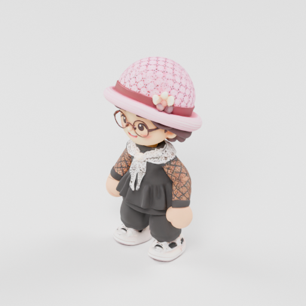

# Molroo characters

Character meshes, embedded textures and rigs. **Animations are loaded separately** from [molroo/animations](../animations/README.md). Paths/checksums are in [manifest.json](manifest.json).

| Character | Model | Preview | Shared motions |
| --- | --- | --- | --- |
| Bob coat | [bob-coat.glb](bob-coat.glb) | [bob-coat.png](bob-coat.png) | [kaykit-medium.glb](../animations/kaykit-medium.glb), 17 clips |
| Boy | [boy.glb](boy.glb) | [boy.png](boy.png) | [kaykit-medium.glb](../animations/kaykit-medium.glb), 17 clips |
| Flower hat girl | [flower-hat-girl.glb](flower-hat-girl.glb) | [flower-hat-girl.png](flower-hat-girl.png) | [kaykit-medium.glb](../animations/kaykit-medium.glb),16 name-compatible clips; motion limits below |

## Bob coat

- Source: `handmade-assets/assets/models/characters/full/bob-coat/v033/model.glb`. The head was lowered 25 mm and the neck compressed vertically. The hair underside was locally fitted above the collar.
- `bob-coat.glb`: 8,259,480 bytes, 180,438 triangles, 103,825 vertices, three meshes, two embedded 1024×1024 base-color maps, zero embedded clips. Metres, +Y up, +Z forward, bind height about 2.195m.
- The existing KayKit Rig_Medium hierarchy, 21 skin joints, inverse binds and hand sockets are preserved. Head uses a single joint. Body and Neck have fitted weights.
- Load the 17 clips from the shared library by original node name. See the [loading example](../animations/README.md#load-once-reuse-per-character). The 512px preview shows shared Idle_A at 0.3s.
- External binding and recombined playback matched over 544 sampled poses, with zero bone or sampled vertex error. Independent skeleton clones were verified. Structure and texture checks reported no issues or warnings.
- Sampled body stretch reached 3.597× in Waving. Walking_C reached about 75mm below the ground in the sole ROI. Shared root-Y keys are unchanged. Continuous collision, native-engine behavior and performance remain untested.
- SHA-256: `01fa574973b5835060c32ab951ffbc5494df9501c23746211c281918f0648228`. Delivery evidence and previous version: `handmade-assets/validation/molroo-characters-distribution/v021/`.

## Sources and notices

References were user-supplied/generated; shape/paint used Hunyuan3D Mini/Paint with local finishing. Provenance remains with the source versions.

- KayKit rig/animations: Kay Lousberg, [CC0 notice](licenses/License-KayKit.txt).
- Installed generation/paint terms: [License-Hunyuan3D-2.0.txt](licenses/License-Hunyuan3D-2.0.txt), [NOTICE-Hunyuan3D-2.0.txt](licenses/NOTICE-Hunyuan3D-2.0.txt).

The component CC0 notice is not a blanket license for the entire character. Staging/separation does not establish additional reference-image rights.

## Boy

- Source: `handmade-assets/assets/models/characters/full/boy/v008/model.glb`. Moved the lower neck 24 mm rearward toward the collar center and retained the jaw fit, neck color and user-painted body atlas. Both 1024px base-color atlases are embedded.
- `boy.glb`: 8,981,148 bytes, 180,444 triangles, 107,506 vertices, three meshes, 21 KayKit Medium joints, original hand sockets and zero embedded clips. Metres, +Y up, +Z forward, bind height about 2.234m.
- Load the current 17 clips by original node names from the [shared library](../animations/README.md#load-once-reuse-per-character). The 512px preview shows Idle_A at 0.3s.
- Structure and texture checks passed. External binding and recombined playback matched across 544 poses, with zero bone matrix and sampled vertex error and independent skeleton clones.
- Maximum sampled edge stretch: 2.911x in Running_B. Minimum sampled sole height: -90 mm in Walking_C. Shared root-Y keys are unchanged. Continuous collision, native-engine behavior and performance remain untested.
- SHA-256: `d20b8e0166330c85213ccbb6fed470e9edd616c63f706af9267bd905de00fee8`. Previous delivery and verification: `handmade-assets/validation/molroo-characters-distribution/v020/`.

## Flower hat girl

- Source: `handmade-assets/assets/models/characters/full/flower-hat-girl/v001/`. User-improved body paint and existing hat/glasses head retained; fitted chest/head neck connector. Original source and editable Blender remain there.
- `flower-hat-girl.glb`: **8,585,596 bytes,179,440 triangles,107,889 vertices**,3 meshes,21 skin joints,two embedded1024px maps,zero embedded clips. Metres,+Y up,+Z forward,bind height about2.234061m. No external textures or compression decoder. Delivery is byte-identical to the approved assembled source.
- Load `../animations/kaykit-medium.glb` once and bind tracks by original node names; use the existing loading example with the new character URL. The512px Cycles preview is actual `Idle_A` at0.3s. Head is a rigid child of the head joint; Body and Neck are skinned.
- Separate library vs source recombined with the same library:16 clips x32=512 poses,786,432 sampled vertex comparisons,joint/vertex error0; independent SkeletonUtils clones verified. This checks binding, not authored animation fidelity or collision safety.
- **Motion deformation is not fully accepted:** the16-clip/384-pose3x diagnostic fails at `Running_B`0.730435s,crotch stretch6.797x. The basic-motion subset also fails at `Walking_B`0.927536s,3.786x; the Idle_A/Walking_A subset fails at Walking_A0.927536s,3.726x. Neck maximum is1.295x. Existing pants/garment compression remains. Do not interpret16 compatible clip names as a deformation-quality pass.
- Grounding review:32 times per clip on original shoe/cuff ROI vertices. Idle_A soles about+1.5~1.7mm,Walking_A minimum about-23.7mm,Walking_B minimum about-24.6mm,Waving about+55.4mm. Running/jump positive ranges may be flight. Shared keys and source rig/weights were retained; no character-specific grounding correction was added.
- Current destination structural/map checks and binding evidence: `handmade-assets/validation/molroo-characters-distribution/v015/`. Original body/head map bytes and all mesh/rig data preserved. Remaining face/hand tone differences, hat/glasses/scarf/shoe paint artifacts and separately embedded neck ends are inherited/documented. No complete continuous collision,target-game/controller/physics or runtime performance test.
- Local publication only; existing Bob coat/Boy assets and animation library GLB unchanged. Common licenses/notices above apply; original user reference provenance remains with source records.
