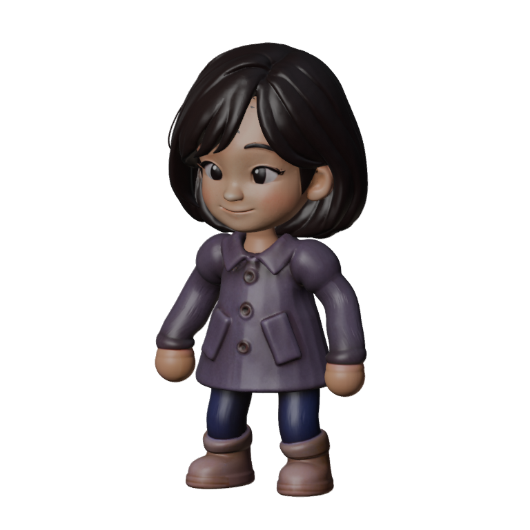

# Molroo characters

Character meshes, embedded textures and rigs. **Animations are loaded separately** from [molroo/animations](../animations/README.md). Paths/checksums are in [manifest.json](manifest.json).

| Character | Model | Preview | Shared motions |
| --- | --- | --- | --- |
| Bob coat | [bob-coat.glb](bob-coat.glb) | [bob-coat.png](bob-coat.png) | [kaykit-medium.glb](../animations/kaykit-medium.glb),16 clips |



## Bob coat

- Uncompressed GLB, **9,942,796 bytes**, two embedded1024x1024 base-color maps. No external textures or compression decoder required.
- **Zero embedded clips.** Load the shared library once; bind its clips by original node name to each character instance. See the [loading example](../animations/README.md#load-once-reuse-per-character).
- Body/Head/Neck:180,762 triangles,106,656 vertices. Head replaced in v020 with the side-part bob head (bob-part-head v001); body, smaller hands, fitted cuffs and curved neck are unchanged from v019.
- Metres,+Y up,+Z forward, original origin/bind transforms; bind height approximately2.129m.
- KayKit Rig_Medium,21 skin joints and original `handslot.l/r` sockets. This is not the older FD2 maker-v2 rig. No separate animator IK controls or facial morphs.
- The768x768 RGBA preview shows Idle_A at0.3s. A loader that opens only the character file shows its default/bind pose until an external clip plays.

## Verification and limits

Source: `handmade-assets/assets/models/characters/bob-coat/v020/model.glb`. The combined original and previous delivery are preserved. Mesh positions/normals/UVs/indices/weights/materials/image bytes, inverse binds and node hierarchy are unchanged; unused animation accessors/buffers were removed. Current SHA-256:

```text
340c42ec8146162b37bf6e4420138391f621ef58a27c636ed866eae0f9b7d83e
```

Actual destination inspect/texture-inspect: exit0, issues/warnings empty. Separately loaded shared clips matched the former combined file at16 clips x32=512 poses: maximum joint-matrix error0 and sampled vertex distance0 (786,432 comparisons). Two skeleton-cloned instances shared clips while keeping independent skeleton state.

Source static geometry/visual/neck-connection checks remain applicable. The20% coat-follow setting still has23 crossing poses in192 sampled lower-coat/pants walk ROI poses; other deep-motion folds remain. This does not certify continuous collision safety, cloth physics, gameplay behavior or runtime performance.

The shared root-Y grounding correction is preserved from bob-coat v019. Other characters need matching rest transforms/proportions and their own sole/grounding review; sharing clips does not retarget arbitrary rigs or add foot IK.

Editable Blender,2048 masters and the combined original remain in handmade-assets. Current separation record: `handmade-assets/validation/molroo-characters-distribution/v003/`; v001 records the earlier combined delivery. App code and remote hosting were not changed.

## Sources and notices

References were user-supplied/generated; shape/paint used Hunyuan3D Mini/Paint with local finishing. Provenance remains with the source versions.

- KayKit rig/animations: Kay Lousberg, [CC0 notice](licenses/License-KayKit.txt).
- Installed generation/paint terms: [License-Hunyuan3D-2.0.txt](licenses/License-Hunyuan3D-2.0.txt), [NOTICE-Hunyuan3D-2.0.txt](licenses/NOTICE-Hunyuan3D-2.0.txt).

The component CC0 notice is not a blanket license for the entire character. Staging/separation does not establish additional reference-image rights.
